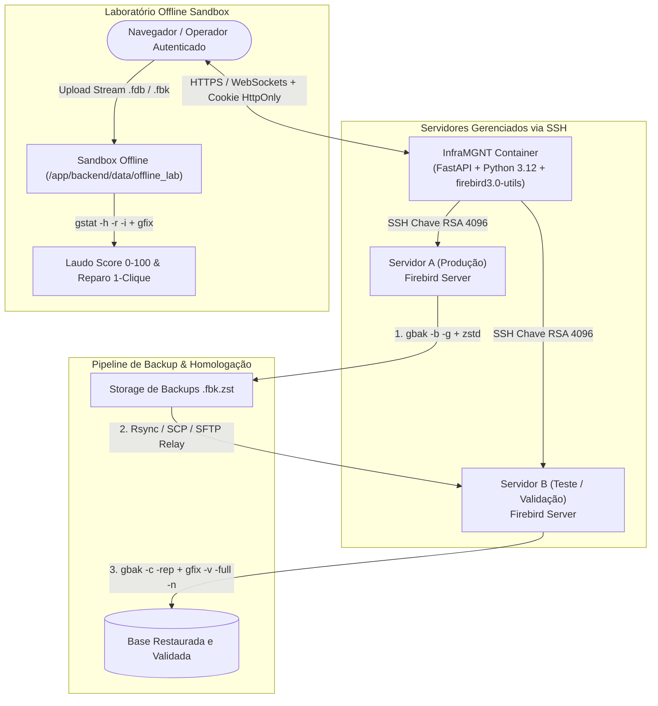

# InfraMGNT - Documentação de Arquitetura e Guia do Projeto

O **InfraMGNT** (`firebird-mnt`) é um painel de controle web projetado para centralizar, blindar e automatizar a gestão de servidores Linux rodando **Firebird Database**. Ele permite disparar rotinas de backup quente na máquina de produção, transportar os arquivos, realizar testes de restore e validação física em uma máquina secundária de homologação, executar manutenção preventiva (índices, `gstat -h`, `gfix -sweep`, tuning Linux) e analisar bases `.fdb` em um **Laboratório de Otimização Offline**, com acompanhamento de logs em tempo real via WebSockets.

---

## 1. Visão Geral da Arquitetura



---

## 2. Estrutura de Módulos e Funcionalidades

### 2.1. Autenticação & Blindagem de Produção (Proxmox Guard)
- **Página de Login Dedicada (`/login`):** Senhas com hash `PBKDF2-HMAC-SHA256`, sessão assinada com `HMAC-SHA256` em cookie `HttpOnly` e proteção contra Brute-Force por IP.
- **Trava Hard contra Restore em Produção:** O backend bloqueia (`HTTP 403`) qualquer execução de `gbak -c` (Restore) ou otimização destrutiva em servidores classificados como `Produção`.
- **Trava Pré-Backup de Espaço em Disco (`df -P`):** Verifica se a partição possui espaço livre antes de iniciar o `gbak -b`.

### 2.2. Painel de Servidores (Hosts)
- **Cadastro de Servidores:** IP/Hostname, porta SSH, usuário, tipo de autenticação (Chave Privada SSH ou Senha) e modo de operação (**Simulação/Homologação** ou **SSH Real**).
- **Status & Inspeção (`gstat -h`):** Indicador visual de conectividade, latência em `ms`, checagem do serviço `systemctl is-active firebird*` e modal de inspeção `gstat -h` (100% *read-only*) + listagem de backups em disco.

### 2.3. Catálogo de Jobs de Backup & Homologação
1. **Job 1: Backup Produção (`gbak -b -g`)** — Caminho `.fdb`, diretório destino, compressão em pipe (`zstd`/`gzip`) e flag `-g` (desativa garbage collection durante o backup).
2. **Job 2: Envio para Servidor de Testes** — Via `rsync` ou `scp` com fallback automático para **SFTP Relay** via container.
3. **Job 3: Restore & Validação de Integridade (`gbak -c` + `gfix`)** — Recria a base no Servidor B e executa `gfix -v -full -n`.
4. **Job 4: Pipeline Completo (1-Clique) + Agendador Cron** — Executa *Backup em A &rarr; Cópia para B &rarr; Restore em B &rarr; Validação `gfix` &rarr; Retenção de Backups Antigos &rarr; Notificação Webhook*.

### 2.4. Rotinas de Manutenção Preventiva & Tuning Linux
Documentadas em [ROTINAS_MANUTENCAO.md](file:///Users/rgerios/Documents/VenosanBancobkp/ROTINAS_MANUTENCAO.md):
- `job_reindex_stats`: Recalcular estatísticas de índices (`SET STATISTICS INDEX`) 100% online.
- `job_check_health`: Diagnóstico *read-only* de `OAT`/`OIT` e transações presas.
- `job_clean_sweep`: Execução manual de `gfix -sweep`.
- `job_full_rebuild`: Ciclo de janela de manutenção (`gfix -shut` &rarr; `gbak` &rarr; `gfix -online`).
- `job_linux_patches`: Auditoria e ajuste de `noatime`, `vm.swappiness=10`, `fstrim.timer` e `apt-mark hold firebird*`.

### 2.5. Laboratório de Análise & Otimização Offline (`.fdb` Sandbox)
- Permite fazer **upload em stream** de um arquivo `.fdb` da máquina local (ou apontar um caminho existente) para análise isolada.
- Executa `gstat -h -r -i` e `gfix -v -full -n`, gerando um **Health Score (0 a 100)**, ranking de tabelas com mais lixo (*backversions*), ranking de índices B-Tree por profundidade (`Depth`) e botões de correção offline em 1 clique (`Sweep`, `SET STATISTICS`, `gfix -mend` e `Rebuild Page Size 16384`).

---

## 3. Estrutura do Repositório

```text
firebird-mnt/
├── backend/
│   ├── app/
│   │   ├── api/
│   │   │   └── routes.py            # Rotas REST, Auth, Offline Lab e WebSockets
│   │   ├── core/
│   │   │   ├── database.py          # Inicialização e schema SQLite
│   │   │   └── security.py          # Hash PBKDF2, tokens HMAC e rate-limit
│   │   ├── models/
│   │   │   └── schemas.py           # Schemas Pydantic de validação
│   │   ├── services/
│   │   │   ├── job_runner.py        # Orquestração de Backup, Restore e Manutenção
│   │   │   ├── offline_analyzer.py  # Motor de Raio-X e Otimização Offline (.fdb)
│   │   │   ├── scheduler.py         # Agendador Cron e Notificações Webhook
│   │   │   ├── ssh_service.py       # Cliente Paramiko SSH, SFTP Relay e gstat
│   │   │   └── ws_manager.py        # Gerenciador de conexões WebSocket em tempo real
│   │   └── main.py                  # Ponto de entrada FastAPI
│   └── requirements.txt
├── frontend/
│   ├── index.html                   # Dashboard principal completo
│   ├── login.html                   # Página de login dedicada
│   ├── js/
│   │   └── app.js                   # Lógica de UI, Upload Offline e WebSockets
│   └── css/
│       └── style.css
├── deploy/
│   ├── docker-deploy.sh             # Script de deploy automatizado em Docker no Linux
│   ├── proxmox-lxc-install.sh       # Instalador direto via Systemd para LXC Proxmox
│   └── inframgnt.service            # Unit file do Systemd
├── Dockerfile
├── docker-compose.yml
├── docker-entrypoint.sh             # Gestão automática de chaves SSH e permissões no container
├── .env.example
├── INFRAMGNT_ARQUITETURA.md
├── ROTINAS_MANUTENCAO.md
└── README.md
```
