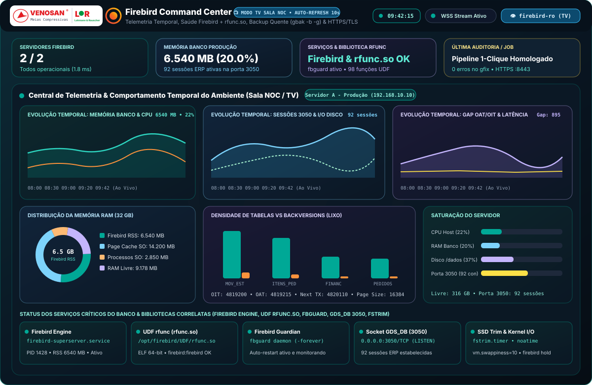
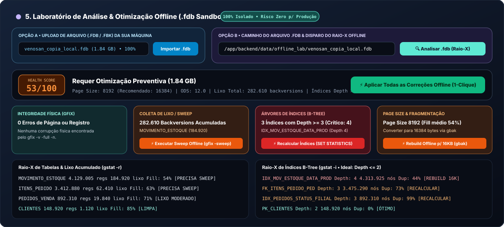

# InfraMGNT (`firebird-mnt`) — Central de Comando Firebird, Telemetria & Laboratório Offline

<p align="center">
  
  
  
  
</p>

O **InfraMGNT** é uma **Central de Comando Web** projetada para gerenciar, monitorar e blindar ambientes críticos Linux rodando **Firebird Database**. Ele une **Telemetria em Tempo Real** (consumo de memória do processo Firebird, conexões na porta `3050`, status da biblioteca UDF `rfunc.so` e `fbguard`), **Orquestração de Backup Quente (`gbak -b -g`) + Validação Física (`gfix -v -full -n`)**, **Manutenção Preventiva** e um **Laboratório de Análise e Otimização Offline (`.fdb` Sandbox)**.

---

## Visão Geral das Telas (Interface Pastel & Alertas Quentes)

A interface foi desenhada com **Semântica Visual de Risco para Operadores e DBAs**:
- **Tons Pastel (Menta, Azul Céu e Lavanda):** Indicam monitoramento, telemetria, inspeção *read-only* (`gstat -h`) e rotinas **100% online** que não geram impacto nem derrubam usuários.
- **Tons Quentes (Âmbar e Vermelho Carmesim):** Destacam atividades com **alto consumo de I/O** (`gbak -b`, `gfix -sweep`) ou **operações críticas que exigem janela de parada** (`job_full_rebuild` com `gfix -shut full`).

### 1. Central de Comando & Telemetria em Tempo Real (`Firebird`, `rfunc.so`, Memória RAM e Sessões)


Ao conectar o servidor de produção via SSH, a **Central de Telemetria** exibe gráficos interativos (**Chart.js**) e o status dos serviços correlatos do ecossistema Firebird:
- **Gráfico de Consumo de Memória RAM:** Separa exatamente quanto de RAM está alocado pelo motor **Firebird (`RSS MB / %`)**, quanto está em **Page Cache do Linux (`.fdb`)**, outros processos e memória livre.
- **Gráfico de Densidade de Tabelas vs Lixo (*Backversions*):** Compara o volume de registros ativos com versões antigas pendentes de *Sweep*, além dos contadores `OIT`, `OAT`, `Next Transaction` e `Gap`.
- **Matriz de Serviços Críticos e Correlatos:**
  - `Firebird Engine` (`firebird-superserver` / `classic`, PID e consumo RSS)
  - **`Biblioteca UDF rfunc (/opt/firebird/UDF/rfunc.so)`**: Verifica presença do binário ELF 64-bit e permissões `firebird:firebird` (essencial para ERPs que dependem de funções UDF).
  - `Firebird Guardian (fbguard)`: Monitora o daemon de auto-restart (`-forever`).
  - `Socket GDS_DB (Porta 3050/TCP)`: Conta em tempo real quantas sessões/terminais do ERP estão conectados no banco (`ss -tn sport = :3050`).
  - `SSD/NVMe Trim & Kernel`: Verifica `fstrim.timer`, montagem `noatime,nodiratime` e `vm.swappiness=10`.

---

### 2. Orquestrador de Backup Quente, Console WebSocket & Manutenção Preventiva


- **Pipeline Completo em 1 Clique:** Executa automaticamente *Backup Quente em Produção (`gbak -b -g` + `zstd`) &rarr; Transferência Segura (`rsync` / `SFTP Relay`) &rarr; Restore no Servidor de Teste (`gbak -c -rep`) &rarr; Validação Física de Páginas (`gfix -v -full -n`)*.
- **Console WebSocket em Tempo Real:** Transmite linha a linha a saída do `gbak`, `rsync` e `gfix` com mascaramento automático de senhas (`********`).
- **5 Rotinas de Manutenção Embarcadas** (detalhadas em [ROTINAS_MANUTENCAO.md](ROTINAS_MANUTENCAO.md)):
  1. `job_check_health` (*Pastel Menta • Risco Zero*): Diagnóstico *read-only* de `OAT`/`OIT` via `gstat -h`.
  2. `job_reindex_stats` (*Pastel Azul • 100% Online*): Recalcula seletividade (`SET STATISTICS INDEX`) via `isql`.
  3. `job_linux_patches` (*Pastel Lavanda • Online*): Audita/aplica `noatime`, `vm.swappiness=10`, `fstrim.timer` e `apt-mark hold firebird*`.
  4. `job_clean_sweep` (*Âmbar Quente • Alto I/O*): Executa `gfix -sweep` fora do horário de pico.
  5. `job_full_rebuild` (*Vermelho Quente • Exige Parada*): Ciclo completo `gfix -shut full` &rarr; `gbak` &rarr; `gfix -online` com trava de confirmação obrigatória.

---

### 3. Laboratório de Análise & Otimização Offline (`.fdb` Sandbox)


Permite importar uma cópia de qualquer arquivo `.fdb` (via **Upload em Stream pelo navegador** ou apontando um caminho no servidor/container) para rodar diagnósticos pesados (`gstat -h -r -i` + `gfix -v -full -n`) **com risco zero para a produção**:
- Gera uma nota de saúde (**Health Score de 0 a 100**).
- Aponta se o banco precisa de **`gfix -sweep`** (mostrando quais tabelas acumulam mais *backversions*), **recálculo de índices** (listando índices com `Depth >= 3` ou `Depth >= 4`), **reparo físico (`gfix -mend`)** ou **conversão para Page Size 16384**.
- Permite aplicar todas as correções na cópia offline com **1 clique**.

---

## Blindagem e Travas Hard de Produção

Para evitar erros humanos de operação em ambiente crítico:
1. **Bloqueio Físico de Restore em Produção (`HTTP 403`):** O backend proíbe por código que o Job 3 (`gbak -c -rep`) ou otimizações destrutivas do Laboratório Offline sejam executados contra qualquer servidor classificado como `Produção` ou contra o caminho do `.fdb` principal.
2. **Checagem Pré-Backup de Espaço em Disco (`df -P`):** Antes de iniciar qualquer `gbak -b`, o sistema verifica se a partição de destino possui espaço livre seguro (< 90% de uso), abortando preventivamente para nunca travar a partição do Firebird.
3. **Autenticação & Controle de Perfil (`Proxmox Guard`):** Login obrigatório com `PBKDF2-HMAC-SHA256`, sessão assinada `HMAC-SHA256` em cookie `HttpOnly`, bloqueio anti-Brute-Force por IP e restrição de rotinas de parada exclusivamente ao perfil `admin`.

---

## Como Fazer o Deploy em Docker no Linux (1 Comando)

No servidor Linux ou container Proxmox com Docker instalado:

```bash
git clone git@github.com:rgerios/firebird-mnt.git
cd firebird-mnt
chmod +x deploy/docker-deploy.sh
./deploy/docker-deploy.sh
```

O script `deploy/docker-deploy.sh`:
1. Gera o arquivo `.env` com uma `INFRAMGNT_SECRET_KEY` exclusiva.
2. Faz o build e sobe o container `inframgnt-server` (equipado com `openssh-client`, `rsync`, `zstd`, `firebird3.0-utils` e timezone `America/Sao_Paulo`).
3. Gera automaticamente o par de chaves SSH persistente do container (`backend/data/ssh/id_rsa`) com permissões estritas e **imprime a chave pública no terminal** para você autorizar nos servidores Firebird (`~/.ssh/authorized_keys`).

### Acesso Inicial
- **Painel Web:** `http://<IP_DO_SERVIDOR>:8000/login`
- **Healthcheck Docker:** `http://<IP_DO_SERVIDOR>:8000/api/health`
- **Usuário Padrão:** `admin`
- **Senha Inicial:** `Venosan@2026` *(altere no botão **admin** no topo direito após o primeiro login)*

---

## Documentação Técnica Complementar
- [INFRAMGNT_ARQUITETURA.md](INFRAMGNT_ARQUITETURA.md) — Arquitetura detalhada, topologia SSH/SFTP Relay e estrutura de módulos.
- [ROTINAS_MANUTENCAO.md](ROTINAS_MANUTENCAO.md) — Guia de comandos Firebird (`gstat`, `gfix`, `gbak`, `isql`), tuning de kernel Linux e Laboratório Offline.
